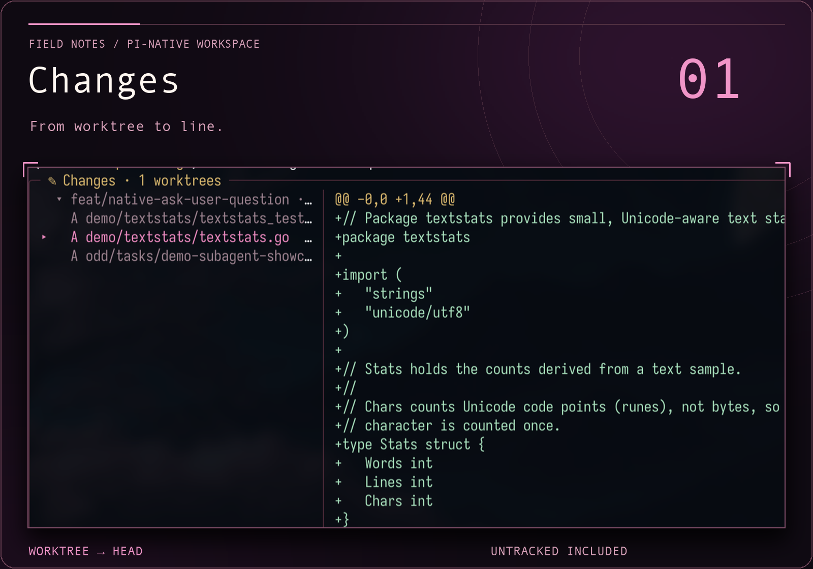
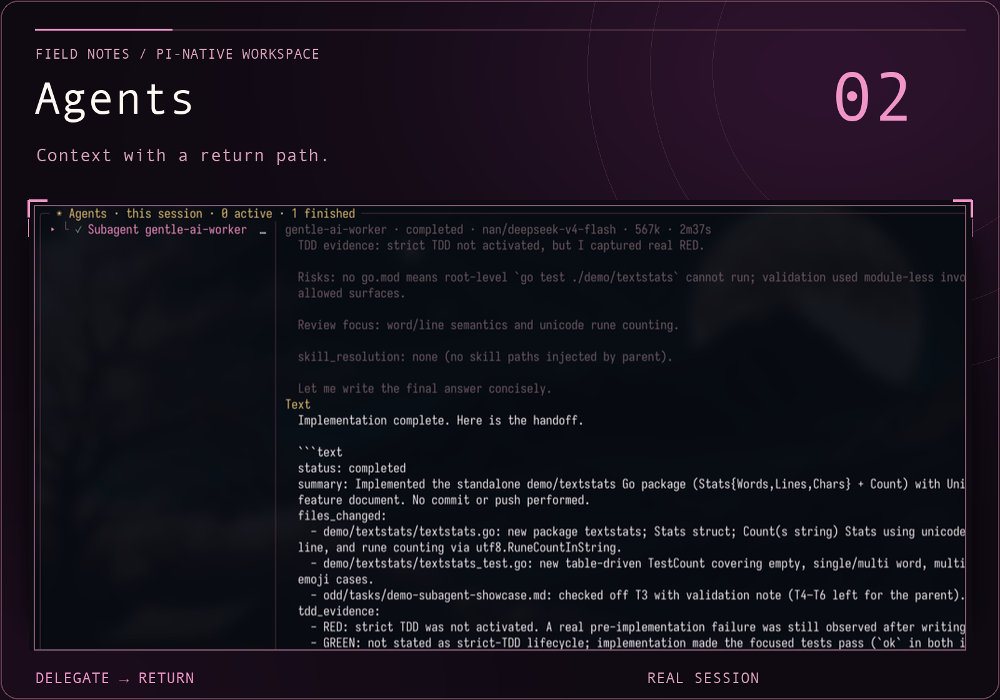
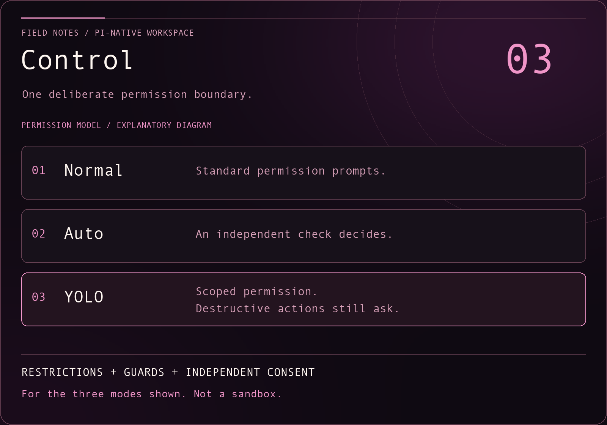

<a id="top"></a>

<h1 align="center">Gentle-Shell™</h1>

<p align="center"><strong>Lead your coding agent, not its scrollback.</strong></p>

<p align="center">gentle-shell brings changes, tasks and focused agents into one Pi-native workspace for controlled development.</p>

<p align="center">
  <a href="https://www.npmjs.com/package/gentle-pi"></a>
  <a href="https://pi.dev/packages/gentle-pi"></a>
  <a href="LICENSE"></a>
  <a href="https://github.com/Gentleman-Programming/gentle-shell/stargazers"></a>
  <a href="https://github.com/Gentleman-Programming/gentle-shell"></a>
</p>

<p align="center">
  <strong>
    <a href="https://gentle-ai.gentlemanprogramming.com/">Website</a>
    &nbsp;·&nbsp;
    <a href="#get-started">Quickstart</a>
    &nbsp;·&nbsp;
    <a href="#documentation">Docs</a>
    &nbsp;·&nbsp;
    <a href="https://gentle-ai-wiki.gentlemanprogramming.com/">Wiki</a>
  </strong>
</p>


<p align="center"><sub><a href="#your-workspace">Explore the full workspace ↓</a></sub></p>

| Lead with… | Keep in view |
| :--- | :--- |
| [01 · Changes](#gentle-changes--what-your-session-left-uncommitted) | Your session’s worktrees, files and diffs against HEAD. |
| [02 · Agents](#gentle-agents--parallel-work-with-a-live-view) | Focused work, live status and a handoff back to the parent. |
| [03 · Control](#control) | Normal, Auto or YOLO — with explicit boundaries intact. |

<p><strong>On this page</strong>:
<a href="#get-started">Get started</a> · <a href="#whats-new-in-v41">What's new</a> · <a href="#your-workspace">Workspace</a> · <a href="#control">Control</a> · <a href="#more-workspace-tools">Tools</a> · <a href="#how-it-works">Workflow</a> · <a href="#also-in-the-box">Components</a> · <a href="#operations">Operations</a> · <a href="#documentation">Docs</a> · <a href="#community">Community</a> · <a href="#about-the-author">Author</a>
</p>

<a id="get-started"></a>

## ⚡ Get started

> ℹ️ **Naming transition:** The product and repository are `gentle-shell`; the npm package remains `gentle-pi`, and its launcher is `gentle-shell`.

**Choose your setup** — follow one route, then [start your first session](#your-first-session).

| Your situation | Installation route |
| :--- | :--- |
| New to Pi | [Integrated installer — no terminal needed](#easiest-download-and-double-click-no-terminal-needed) |
| Already use Pi | [Add the package to your existing Pi](#path-b-inside-an-existing-pi) |
| Prefer npm and a separate environment | [Standalone `gentle-shell` launcher](#path-a-standalone-gentle-shell-recommended-no-pi-changes) |
| Working from a clone | [Browser installer from a checkout](#path-c-browser-installer-from-a-checkout) |

<a id="easiest-download-and-double-click-no-terminal-needed"></a>

### New to Pi: integrated installation

The installer is a preview: it is tested on Linux and in CI, while clean-machine runs on macOS and Windows are still being verified. How it works and what it changes: **[installation wizard](docs/install-wizard.md)**.

> ⚠️ **Your computer will warn you the first time.** These installers are not signed with an Apple or Microsoft developer certificate yet, so the system cannot verify who made them. That warning is expected; here is how to continue:
>
> Only download from this repository's [Releases](https://github.com/Gentleman-Programming/gentle-shell/releases) page. To check a download, compare its SHA-256 with [gentle-shell-installers-SHA256SUMS.txt](https://github.com/Gentleman-Programming/gentle-shell/releases/latest/download/gentle-shell-installers-SHA256SUMS.txt).

<details>
<summary>First-run OS warnings</summary>

> - **macOS:** you see *"Install Gentle Shell.command" Not Opened* (or *cannot be opened because Apple cannot check it*). Click **Done**, open **System Settings → Privacy & Security**, scroll down to the message about *Install Gentle Shell.command*, click **Open Anyway**, and confirm with your password. On older macOS versions you can instead right-click the file, choose **Open**, then **Open** again. You only do this once.
> - **Windows:** you see *Windows protected your PC*: click **More info**, then **Run anyway**. If you see *Open File – Security Warning* instead, click **Run**.
> - **Linux:** if double-click opens the file in an editor, run `sh install-gentle-shell.sh` in that folder instead.

</details>

1. **Download and extract** the installer for your computer:

   | System | Download | After extracting |
   | :--- | :--- | :--- |
   | macOS | [macOS ZIP](https://github.com/Gentleman-Programming/gentle-shell/releases/latest/download/gentle-shell-installer-macos.zip) | Open the zip, then double-click **Install Gentle Shell.command** in the *Gentle Shell Installer* folder. |
   | Windows | [Windows ZIP](https://github.com/Gentleman-Programming/gentle-shell/releases/latest/download/gentle-shell-installer-windows.zip) | Right-click the zip → **Extract All**, open the extracted *Gentle Shell Installer* folder, then double-click **Install Gentle Shell.cmd**. It does not run inside the zip. |
   | Linux | [Linux archive](https://github.com/Gentleman-Programming/gentle-shell/releases/latest/download/gentle-shell-installer-linux.tar.gz) | Extract it, then double-click **install-gentle-shell.sh**. If scripts do not run from your file manager, run `sh install-gentle-shell.sh` in that folder. |

2. **Review the plan in your browser and confirm.** A small window opens first; keep it open and use the browser tab it opens until installation finishes. The installer installs what is missing (Node.js, pnpm, Pi and Gentle Shell) or updates what you have. Nothing is installed until you confirm; preparing the plan may download Node.js and pnpm into a temporary folder that is removed afterwards.
3. **Continue to [Your first session](#your-first-session).** A new installation keeps its own Node.js, npm, pnpm and Pi in `~/.gentle-shell`; your own tools are not used or changed. See [bundled installation](docs/install-wizard.md#bundled-installation) for details.

<a id="path-b-inside-an-existing-pi"></a>

### Already use Pi: add the package

1. **Install the stable release** into your existing Pi:

   ```bash
   pi install npm:gentle-pi@4.1.0
   ```

2. **Exit and restart Pi.** Then, in a terminal, synchronize the installed assets:

   ```bash
   gentle-ai sync
   ```

3. **Continue to [Your first session](#your-first-session)** using `pi` to open your project.

See the [v4.1.0 release notes](https://github.com/Gentleman-Programming/gentle-shell/releases/tag/v4.1.0). If Pi reports that builtin codemode was not loaded, see [why this warning appears and how to silence it](docs/readme-reference.md#builtin-codemode-warning).

<a id="path-a-standalone-gentle-shell-recommended-no-pi-changes"></a>

### Prefer npm: standalone `gentle-shell`

`gentle-shell` opens Pi with this package loaded without installing it into your existing Pi agent or editing its `settings.json`. It requires Pi 1.2.0 or newer.

1. **Install the launcher** in your terminal:

   ```bash
   npm i -g gentle-pi
   ```

2. **Choose your home** when starting your [first session](#your-first-session):
   - `gentle-shell` — a separate home, automatically set up on first run; leaves your Pi installation untouched.
   - `gentle-shell --link` — reuse your Pi sign-ins, models and chats instead.

For home locations, companion packages, theme defaults, manual setup, credential import and its refresh-token tradeoff, see [Standalone homes and sign-in](docs/readme-reference.md#standalone-homes-and-sign-in). Full flags, environment variables and forwarded arguments: [launcher reference](docs/readme-reference.md#gentle-shell-launcher).

<a id="path-c-browser-installer-from-a-checkout"></a>

### Working from a clone: browser installer

Start the same browser installer from a checkout:

```bash
git clone https://github.com/Gentleman-Programming/gentle-shell.git
cd gentle-shell
```

Then run **one** command for your system:

| macOS / Linux | Windows (cmd) |
| :--- | :--- |
| `sh scripts/bootstrap.sh` | `scripts\bootstrap.cmd` |

Use the browser tab it opens: its private `127.0.0.1` link works once and expires after 2 minutes. Review the plan, choose **Latest release** (recommended) or **Latest main** (development builds), and confirm before installation changes anything. Missing Node.js and pnpm may be downloaded temporarily to open the wizard; checkout dependencies are not needed (`pnpm install` is not required).

Existing tools may be reused or updated; the plan explains the changes. For channel differences, build-time Go downloads, version-manager handling, Windows checks and exact update rules, see [Browser installer from a clone](docs/readme-reference.md#browser-installer-from-a-clone). Then continue below.

<a id="your-first-session"></a>

### Your first session

1. **Open your project in a terminal**, then start the launcher for the route you installed:

   ```bash
   cd /path/to/your/project
   ```

   | Installation | Run in that terminal |
   | :--- | :--- |
   | Integrated installer or standalone npm | `gentle-shell` |
   | Package added to an existing Pi | `pi` |
   | Standalone npm, reusing your Pi home | `gentle-shell --link` |
   | Browser installer from a clone | `gentle-shell` (open your project, not necessarily the installer checkout) |

   **Expected:** an interactive workspace with a prompt editor and a footer showing your current folder and model.

2. **Connect a provider inside that workspace:** enter `/login`, choose a provider, and follow its subscription or API-key prompts. Skip this if your selected home already has working credentials. Then enter `/model` and choose a model available to that provider. Provider access may require a paid subscription or usage credits; see [Pi's provider setup](https://github.com/earendil-works/pi/blob/main/docs/models.md) for environment-variable authentication, local models and other options.
3. **Send a read-only first prompt:**

   ```text
   Explain how this repository is organized and how to run its checks. Do not modify any files.
   ```

   **Expected:** the agent inspects the project and replies with its structure and check commands, or explains what it could not determine. It should not modify files. A provider authentication or model-access error means this step has not succeeded yet; check `/login` and `/model` before proceeding.

### Check your setup

Run these **inside the Pi workspace**, not in your terminal shell:

| Command | What to look for |
| :--- | :--- |
| `/gentle:status` | `el Gentleman package is active.` followed by package-assets and global model-configuration details. If assets are missing or stale, follow the repair guidance it prints. |
| `/gentle:doctor` | Diagnostic lines marked `pass:`, `warn:` or `fail:`. Resolve `fail:` entries using their `remedy:` guidance. Missing optional memory tools or a skill registry can produce warnings without preventing your first conversation. |

A successful first reply confirms provider/model access; the diagnostics check the package setup. Neither alone proves the other.

**Setup details:** [codemode warning](docs/readme-reference.md#builtin-codemode-warning) · [STATUS timing diagnostics](docs/readme-reference.md#diagnose-status-timing-without-retrying-it) · [install-time fullscreen](docs/readme-reference.md#install-time-fullscreen) · [interactive RPC hosts](docs/readme-reference.md#interactive-rpc-hosts).

For updates and removal, see [Operations](#operations). For the product tour, continue below.

<div align="center">
 <a id="-see-it-in-action"></a>
 <h3>See it in action</h3>

   <p>
   One prompt, from idea to reviewed commit: memory, workflow, and evidence in a real session.
   </p>

https://github.com/user-attachments/assets/fa5c0cfe-06e7-4c0d-bd6e-8ac7cb934339


<details>
<summary>Spanish subtitles</summary>

https://github.com/user-attachments/assets/6d2bc422-a4dd-4ecf-a04b-fcd3bea7fea9


</details>

</div>

<p align="center"><strong>BUILT FOR PI</strong> &nbsp;·&nbsp; Shaped by Gentle-AI &nbsp;·&nbsp; Coding-agent workspace &nbsp;·&nbsp; Focused agents &nbsp;·&nbsp; ODD</p>

<p align="center">
  
</p>

<a id="whats-new-in-v41"></a>

## ✨ What's new in v4.1

The [v4.1.0 release](https://github.com/Gentleman-Programming/gentle-shell/releases/tag/v4.1.0) makes Gentle Shell installable on a clean machine and pins Gentle AI v4.1.1:

- **Clean-machine installers:** a browser wizard and double-click installers for macOS, Windows, and Linux install what is missing, update what you have, and ask once before changing anything. See [Get started](#get-started).
- **Bundled Gentle Shell:** a new installation keeps its exact Pi, pinned Gentle AI, Engram, and state in one prefix; existing global installs can migrate, the launcher offers updates, and `gentle-shell self-uninstall` removes it.
- **Background jobs and monitors:** `bash_background` wakes the agent once when a command exits, and `monitor` turns each output line of a long-running command into an event. Inspect them with `/gentle:jobs` ([Background jobs](#background-jobs)).
- **Contextual Auto permissions:** Auto decides with the conversation's context and image input, retries provider failures, and can be the saved default ([Permission modes](#permission-modes--normal-auto-or-yolo)).
- **Cross-session coordination:** sessions publish a recognizable subject, task aliases, repository scope, and a bounded work classification that other sessions can list, search, and consult with explicit cost permission.
- **Session-bound profiles:** the active profile binds to the parent session, and orchestrator and reviewer routing apply per session.
- **Delegate for a reason and review by risk:** see [Focused agents](#focused-agents--context-with-a-return-path), [ODD](#odd--the-everyday-workflow), and [Native review](#native-review--review-the-exact-change).

<p align="center">
  
</p>

<a id="your-workspace"></a>

## 🖥️ Your workspace

A bare terminal answers "what is the agent doing?" only with scrollback. gentle-shell turns your Pi session into a workspace: agent orchestration, live changes and runtime status, usage monitoring for supported provider accounts, and built-in diff views — so you lead the work instead of chasing it.

<a id="gentle-shell--your-coding-agent-in-the-workspace-you-lead"></a>


<p align="center"><sub>gentle-shell in action. Screenshot from <a href="https://raw.githubusercontent.com/Gentleman-Programming/gentle-ai/main/docs/assets/features/gentle-shell.png">Gentle-AI</a>.</sub></p>

[Docs →](docs/gentle-shell.md)

---

<a id="gentle-changes--what-your-session-left-uncommitted"></a>

### Gentle Changes

What your session left uncommitted.



<p><sub>Detail crop from the real viewer; open the full source below. The scene is illustrative, not output from a new quickstart task.</sub></p>

You should not have to run `git status` in every worktree to find out what your agents left behind. Gentle Changes shows the current Git state — working tree against HEAD, untracked files included — of your session's repository plus every worktree its subagents used, one group per root. Commit and it disappears; remove a worktree and its group goes with it. Nothing runs at startup; `alt+g` opens a full-screen two-pane viewer with per-file line counts and lazy diffs, `F` hides the file list to read the diff at full width, and `o` drops the real file into your editor.

<details>
<summary>Changes screenshot (full source)</summary>


</details>

[Docs →](docs/gentle-shell.md#browse-changes)

---

<a id="gentle-agents--parallel-work-with-a-live-view"></a>

### Gentle Agents

Parallel work with a live view.



<p><sub>Detail from the real Agents overlay: one completed worker and its handoff, not a demonstration of concurrent active jobs or output from the first-session prompt. Full overlay and a separate session example are expandable below.</sub></p>

Delegating work should not mean losing it. Every subagent runs as its own process with a live card above the editor — model, tokens, cost, elapsed — and `alt+a` opens the full view with retained threads, stop controls, and history restored on resume. A child can ask you a question as an ordinary dialog, and background results come back as cards that start a new turn — nothing polls.

<details>
<summary>Secondary example: full agent/task session (historical workflow)</summary>


</details>

<details>
<summary>Agents screenshot (full source)</summary>


</details>

[Docs →](docs/gentle-shell.md#gentle-agents)

<a id="control"></a>

## 🛡️ Control

The diagrams in this section cover only Normal, Auto and YOLO; [Super Yolo](docs/yolo-mode.md#super-yolo) is a separate, higher-risk mode with different permission boundaries.



<p><sub>Explanatory graphic, adapted from the permission model below — not a product screenshot.</sub></p>

<a id="permission-modes--normal-auto-or-yolo"></a>

### Permission modes

Normal, Auto, or YOLO.

<details>
<summary>Permission-mode diagram (full reference)</summary>


</details>

- Choose `/gentle:mode auto` to check eligible actions with an independent inference using the current session model. Ordinary checks are tool-free; an eligible script check can inspect at most two complete files ([inspection limits](docs/auto-permission-evidence.md)).

  <details>
  <summary>Auto coverage and defaults</summary>

  Auto covers primary file/shell/custom/MCP tools and nested calls through the SDK pipeline while retaining explicit restrictions, destructive guards and independent consent. It adds separately recorded inference cost and latency; unavailable or stale decisions do not run the action. This is not a sandbox or a claim of proprietary classifier parity.

  Save `/gentle:mode default auto` or `/gentle:mode default yolo` to use either optional mode in new primary sessions. `/gentle:mode normal` changes only this session; `/gentle:mode default normal` changes future sessions. Children retain their existing delegation rules, not the parent's elevated mode.

  </details>

[Commands, scope, cost and limits →](docs/permission-modes.md)

<a id="-yolo---scoped-permission-destructive-guards-intact"></a>

---

<a id="yolo--scoped-permission-destructive-guards-intact"></a>

### YOLO

Scoped permission, destructive guards intact.

> 🚀 **Full speed, destructive actions still ask.** YOLO removes repeated permission questions for ordinary already-scoped work, which suits long autonomous runs. Destructive operations still require fresh confirmation.

- `/gentle:yolo enable` supplies standing permission for ordinary already-scoped implementation, checks, commits, non-force pushes and PR creation.

  <details>
  <summary>YOLO behavior and controls</summary>

  - **Default:** **OFF** unless selected or saved as the global default, with interactive primary TUI controls and live session/workspace binding; `/gentle:yolo disable` revokes it and `/gentle:yolo status` checks it.
  - **Menu:** With no argument, `/gentle:yolo` opens a menu (`enable`, `disable`, `status`) showing the current state; cancelling changes nothing, and without an interactive menu it reports status.
  - **Lifetime:** Reload and session replacement revoke live grants; new primary instances may apply the saved global default.
  - **Status:** Active status plus a separate widget show **🚀 YOLO ON 🔥 — destructive confirmations remain**.
  - **Still mandatory:** Explicit restrictions, configured confirmations/blocks, consequential unresolved choices, destination/credential ambiguity and native consent/recovery decisions remain mandatory. Children get no independent delivery grant. This is not a sandbox.

  - **From Customize:** Or open `/gentle:customize` → **Editor** and select **YOLO: OFF · session only**, immediately below Vim. Enter or Space toggles the same live-session permission as `/gentle:yolo`; browsing and previews never activate it. This live toggle does not save a preference. The separate **Session permissions** and **Default permissions** rows select a current mode or save a user-global default, respectively; repository settings and visual profiles cannot grant either mode.

  </details>

[Use and limits →](docs/yolo-mode.md)

<p align="center">
  
</p>

<a id="more-workspace-tools"></a>

## 🧰 More workspace tools

<a id="profiles-and-model-routing--one-deliberate-decision-per-knob"></a>

### Profiles and model routing

One deliberate decision per knob.


Model, effort, and who does what should be choices, not accidents. Named profiles route the orchestrator atomically and independently from packaged and review roles; a repository can pin its profile so its subagents stop following the globally active one, and the panel always shows the routing the runtime actually uses.

[Docs →](docs/readme-reference.md#agent-model-profiles)

---

<a id="command-palette--every-command-one-keystroke-away"></a>

### Command palette

Every command, one keystroke away.


Extension commands are only useful if you can find them. `alt+k` opens a curated, grouped palette — Configuration, Session, Diagnostics, and Skills — searchable by label, command name, or description, showing entries only when they are actually registered.

[Docs →](docs/gentle-shell.md#command-palette)

---

<a id="customize--look-layout-and-editor-in-one-panel"></a>

### Customize

Look, layout, and editor in one panel.

- `/gentle:customize` opens an interactive panel to set animation quality, startup banner rose, text logo and color, or choose an installed Pi theme.

  <details>
  <summary>Customize controls: <code>/gentle:customize</code></summary>

  - **Themes:** Highlighting a theme previews its source palette without changing the active theme; press Enter or Space to apply it through Pi. If its source is unreadable, the preview is unavailable.
  - **Status layout:** Status defaults to a right rail in fullscreen terminals at least 140 columns wide, and to a bottom bar otherwise. Choose right, bottom, or hidden (which removes both the rail and the bottom status bar at every width), move the fullscreen header below the input (below the 140-column breakpoint only one status row paints: a top header replaces the bottom bar, while with the header below the input the bottom bar alone carries the header's context, cost, and usage plus extension statuses), select comfortable/compact/minimal density, and toggle Changes, Agents, TODO, usage/cost, and model details independently. Layout changes and reset take effect immediately; banner changes appear on the next startup.
  - **Vim:** The Editor category offers explicit Vim enable/disable controls for the global prompt preference; highlighting shows the persisted preference and effective prompt state without changing either. Enter or Space saves it and updates the live prompt; unsupported editors keep ordinary editing even when the saved preference is on. Vim is not included in visual profiles or visual reset.
  - **History:** The History category turns prompt-history capture on or off; it is off by default, applies to the next prompt without a restart, and never deletes stored history. An explicit `GENTLE_PI_HISTORY_CAPTURE` value overrides the saved choice, and the panel marks that override (see [Prompt history](docs/prompt-history.md)).
  - **Reset and profiles:** The panel can reset visual, banner, and animation settings to defaults. Press `p` for named visual profiles: `s` saves the current installed theme, banner, animation and layout; select a profile with ↑/↓, then use `r` to replace, `a` to apply, or `d` to delete. `z` clears only the profile catalog. Confirm destructive/apply actions with `y`, or cancel with any other key; Esc returns without applying a preview. Applying independent stores is not atomic: partial failures identify what changed.

  </details>

[Card style and content →](docs/gentle-shell.md#card-style)

---

<a id="audio-notifications--opt-in-sounds-for-success-errors-and-attention"></a>

### Audio notifications

Opt-in sounds for success, errors, and attention.


- Open `/gentle:customize` → **Notifications** (the card header reads **Audio notifications**) and configure audio directly in the same two-column card, with no nested menu. Audio starts off; RPC and children stay silent.

  <details>
  <summary>Audio controls and platform support</summary>

  - **Controls:** Enter toggles the master switch or cycles a type/event through silence/success/error/attention, `f` assigns a literal absolute local WAV/OGG/FLAC sound (≤2 MiB, ≤10 seconds) to the highlighted **Success**, **Error** or **Attention** type (each type keeps its own sound), and `p` previews its assigned sound. **Advanced** folds per-event exceptions; the type choices stay independent.

  - **Quick answer (Linux/WSLg):** on plain Linux the installed package prefers the native WAV backend and needs no external player — it talks to a local PulseAudio/PipeWire-Pulse Unix socket and requires a running server with a default sink.
    - Inside **WSL** the Windows system `SoundPlayer` is preferred instead: the validated WAV snapshot is mapped to a `\\wsl.localhost\<distro>\...` UNC path, so no Pulse server or RDP audio dependency is required; it does depend on the default `/mnt/c` automount and the standard `C:\Windows` root and otherwise falls back to the trusted Linux CLI before any playback.
  - **Native Windows** WAV uses the same system `SoundPlayer` through the fixed `C:\Windows\...\powershell.exe` host. A read-only probe succeeded here, but that is not a claim of physically heard audio.
  - OGG/FLAC keep the legacy CLI backend (`paplay`/`pw-play`/`aplay`) on Linux and WSL; native codecs are a future phase and Windows OGG/FLAC is unsupported. macOS keeps `afplay` for WAV and FLAC while an own CoreAudio phase is planned.

  </details>

[Usage, limits and verification →](docs/sound-notifications.md)

---

<a id="background-jobs--inspect-what-runs-in-the-background"></a>

### Background jobs

Inspect what runs in the background.

- Use `/gentle:jobs` to inspect this session's background commands and monitors. Running jobs appear first; each group is ordered newest first. Arrow keys select a job, `Tab` opens details on narrow terminals, `s` stops a running job, and `q` closes the modal.

  The Status panel has a **Jobs** section with each running job's description. When the panel is hidden or unavailable in the compact/mobile layout, the top or bottom bar shows only the running count (`⧗ 1 job`). The count and descriptions disappear when no jobs remain active; `/gentle:jobs` retains completed jobs for inspection.

[Docs →](docs/gentle-shell.md#background-jobs)

<p align="center">
  
</p>

<a id="features"></a>

<a id="how-it-works"></a>

## 🧠 How it works

<a id="el-gentleman--think-before-you-build"></a>

### el Gentleman

Think before you build.


Say what you need once, then keep moving. el Gentleman helps turn intent into clear scope, a sensible next step, and evidence people can review — without making every task feel like a process meeting.

[Docs →](docs/readme-reference.md#organic-driven-development)

---

<a id="odd--the-everyday-workflow"></a>

### ODD

The everyday workflow.


**Organic Driven Development (ODD)** is the everyday path: questions, reviews and proposals stay read-only until you ask for a change; the agent explores before changing anything, clarifies only real decisions, and keeps small understood work small. Substantial, authorized work gets one recoverable feature document — mirrored in memory when available — so progress, evidence, and the next step survive an interruption; behavior changes are test-first by default when a runnable test applies.

<details>
<summary>Task sizing and handoffs</summary>

Tasks are sized by understanding, risk, and resumability: work that is understood, touches no high-risk item, and could be finished from the request and `git diff` alone runs inline, with no subagents and no task document. Work becomes large only when it can't be resumed from the diff — several sessions, external waits, or requirements too long to survive compaction — never because of its size. The feature document quotes your spec verbatim, and every handoff points at it instead of paraphrasing it, so exact strings, error messages, and examples reach the workers intact.

</details>

[Docs →](docs/readme-reference.md#organic-driven-development)

---

<a id="focused-agents--context-with-a-return-path"></a>

### Focused agents

Context with a return path.


Bring in help without losing the thread. Focused package-owned Pi agents can map a codebase, implement a bounded change, or verify it, while one parent stays accountable for the scope, the decisions, and the final summary.

<details>
<summary>When the parent delegates</summary>

The parent delegates for a reason, not for size. Understanding that outgrows one inline batch (about 3 calls and 10k tokens) gets one read-only explorer; two or more independent units of behavior, each big enough to outweigh a subagent's start-up and with disjoint edit surfaces, get parallel writers; a change that touches a named high-risk item gets an independent verifier, whatever model wrote it; a long session hands its next unit to a fresh worker. Without a named reason the parent works inline — file count and task size never decide the route.

</details>

[Docs →](docs/readme-reference.md#how-the-harness-decides-what-to-do)

---

<a id="measured--what-proportional-routing-changed"></a>

### Measured

What proportional routing changed.


The routing rules came from benchmarks. These runs use a local benchmark with hidden acceptance suites; each cell is a single run (n=1), and cost is API-equivalent.

| Scenario | Before | After |
| :--- | :--- | :--- |
| 3-line bug in one function | 335 s · 56 turns · $0.339 | **77 s · 10 turns · $0.105** — inline, no subagents |
| Bug rooted in shared logic | 479 s · $0.361 | **276 s · $0.207** — one explorer |
| Data migration (high risk) | 559 s · $0.403 · needed a feedback round | 539 s · $0.555 · **accepted on the first round** — one independent verifier |
| 73-line spec, 26 hidden checks | Paraphrased handoffs: 13 failing, still 23/26 after two feedback rounds | Spec passed by reference ([#1718](https://github.com/Gentleman-Programming/gentle-shell/pull/1718)) |

Against the same model in Codex CLI, with blind review of every solution, Gentle Shell was accepted on the first round in every cell and ranked higher on the medium (3 of 3 runs) and large tasks; it was close on the small one. The large task still took about three times longer (17.5–17.9 min vs 6.1 min) — that gap is open work. Sources: [#1723](https://github.com/Gentleman-Programming/gentle-shell/pull/1723), [#1794](https://github.com/Gentleman-Programming/gentle-shell/pull/1794), [#1713](https://github.com/Gentleman-Programming/gentle-shell/issues/1713).

---

<a id="native-review--review-the-exact-change"></a>

### Native review

Review the exact change, not a moving target. Native review keeps one candidate in view, returns risk-scoped evidence, and can surface a bounded correction path. You still decide what happens next in your repository.


<details>
<summary>Review scope</summary>

Review is proportionate: an independent verifier runs only for a named high-risk item in every RDD state, a review is only due for high-risk work, and the agent forwards the 4R lenses that fit what it touched — with its reason — instead of paying for all four.

</details>

> ℹ️ **RDD is optional and on by default:** turn native receipt-driven development off anytime with `/gentle:review-mode disable` (this clone) or `gentle-ai review mode disable` (machine-wide); `/gentle:review-mode status` shows the current mode. The `.git/gentle-ai/candidate-views` parent must sit on a filesystem that honors private POSIX modes (or equivalent Windows ACLs); WSL DrvFS mounts without metadata can reject START before lineage creation.

<details>
<summary>Reviewer transport</summary>

Reviewer completions inherit Pi's effective `transport` preference when an acknowledged individual or grouped capture executes. The host forwards a defined value unchanged, with one settings snapshot per group; it never forces SSE or changes model routing. An absent setting or an older Pi API without `getSettings()` preserves the provider default. This completion preference is separate from native `pi_host_relay` coordination, and providers that do not support it may ignore it.

</details>

[Docs →](docs/review-integration.md)

<p align="center">
  
</p>

<a id="also-in-the-box"></a>

## 📦 Also in the box

| Component | What it does |
| :--- | :--- |
| Startup and runtime panel | A configurable gentle-shell entry point and visible runtime state for Pi. |
| Skills and delivery guidance | Package skills for documentation, issue work, PRs, reviews, and reviewable work units. |
| Model, effort, persona, and profile controls | Explicit knobs for how Pi routes and presents work. |
| Safety boundaries | Guards around destructive operations and sensitive-path handling. |
| Optional companion packages | Extra capabilities you may choose to add; persistent memory is **not** bundled with the npm package `gentle-pi`. The self-contained Gentle Shell installer includes its own pinned Engram core; see [bundled installation](docs/bundled-install.md#layout). |
| Fullscreen workspace layout | Header row plus a scrolling Status → Changes → TODO rail on wide terminals. |
| Live status bar and prompt petal | One-line gauge, cost, and statuses; the petal shows `working` and `queued`. |
| Parent ↔ subagent communication | Delegate, steer, reply, and cross-session notification within your local profile. |
| Native interactive tools | Built-in questions, choices, and review captures — no third-party dependency. |
| Gentle Todo | A plan card that turns amber when the model lets it go stale. |
| Subscription usage | Per-window meters and resets for supported provider accounts. |
| Gentle Stats | `/gentle:stats` shows local usage history: activity heatmap, tokens, cost, streaks, and per-model share. |
| Gentle Music | `/gentle:music [mood]` opens the gentle-stream player full screen; `b` returns to Pi with the music playing. `next`, `pause`, `play`, `stop`, and `status` control it in place. [Details](docs/gentle-music.md). |
| Gentle Voice | Optional local dictation: `/gentle:voice` downloads Parakeet once, then pastes what you say into the draft without sending it. [Details](docs/voice.md). |
| Gentle notices | Gentle AI calls and review reminders as cards in the transcript. |

<details>
<summary>Cross-orchestrator message cards</summary>

Cross-orchestrator messages appear as compact `🤖 Sender → 🤖 Recipient` cards with single-row headings. Expand a card to inspect available identifiers and reasons. **Message queued** means queued, not delivered or read; long names are clipped to fit narrow terminals.

</details>

Every component, skill and preset: [Full breakdown →](docs/gentle-shell.md)

<a id="nan-model-provider--first-party-no-extra-package"></a>

### NaN model provider

First-party, no extra package.

- The first-party `nan` provider is included; no third-party provider package is required. Set `NAN_API_KEY` before starting Pi, or use native `/login` → NaN (also `/login nan`), then use `/model` to select a model.

  <details>
  <summary>NaN login, models and thinking levels</summary>

  - **Login:** Both login routes await explicit API-key input; blank or whitespace-only entries fail without saving a credential, and surrounding whitespace is trimmed. Cancellation leaves the stored key unchanged. Stored keys take precedence over `NAN_API_KEY`.
  - **Streaming:** Pi streams chat completions through its OpenAI-compatible provider.
  - **Model discovery:** Model discovery intersects NaN's authenticated `/v1/models` response with a maintained subset of known chat IDs from the [official model documentation](https://nan.builders/docs/models); unknown and non-chat IDs are omitted. A successful response with no known chat IDs stays empty. Documented context, reasoning, and text/image capabilities are preserved with conservative numeric bounds for abbreviated limits; audio input is not advertised by Pi.
  - **Output caps:** The provider configures `maxTokens` caps rather than claiming undocumented model maxima: 32,768 for GLM 5.3, GLM 5.3 Flash, and MiMo; 16,384 for DeepSeek V4 Flash; 65,536 for Gemma 4 and Qwen 3.6; and 131,000 for Qwen 3.8 Flash (NaN documents 131K). Reasoning shares the output budget.
  - **Offline fallback:** Before a successful refresh, all seven documented chat models are available as the offline fallback in `/gentle:models`: `glm5.3`, `deepseek-v4-flash`, `glm5.3-flash`, `qwen3.8-flash`, `mimo-v2.6-flash`, `gemma4`, and `qwen3.6`. This fallback declares documented support, not proof of access for your key. Once refreshed, the successful live key-scoped list remains authoritative (including an empty list), even offline or after a failed refresh. Changing credentials resets the catalog to the full documented fallback until discovery succeeds for the new key.
  - **Not included:** NaN MCP search and media bridges are not included.

  - Thinking levels follow NaN's [reasoning contract](https://nan.builders/docs/models):

    | Models | Pi thinking levels |
    | --- | --- |
    | GLM 5.3 / GLM 5.3 Flash | `low`, `medium`, `high`, and `max` are fully controllable. No `off`; Pi's `minimal` and `xhigh` clamp to `low` and `max`. |
    | Qwen 3.6 / Gemma 4 | `off` sends `none` and `minimal` also skips reasoning; `low`, `medium`, `high`, and `max` set reasoning budgets. Pi's `xhigh` clamps to `max`. |
    | DeepSeek V4 Flash / Qwen 3.8 Flash / MiMo | The same `off` (`none`), `minimal`, `low`, `medium`, `high`, and `max` levels are accepted, but NaN manages their reasoning depth, so no value changes it. Pi's `xhigh` clamps to `max`. The header reports `effort: auto` for these three and a one-time notice says the level does not change the depth. |

  </details>

<p align="right"><a href="#top">Back to top ↑</a></p>

<p align="center">
  
</p>

<a id="operations"></a>

## 🔧 Operations

### Keep it up to date

- **Release compatibility:** `upgrade` is available from `gentle-pi` v4.1.0 (and in main builds containing commit `96ff045a8`). Releases through v4.0.0 do not support it: on those launchers, `gentle-shell upgrade` opens a session with `upgrade` as the prompt instead of updating.

  For those installations, download the [latest installer](#easiest-download-and-double-click-no-terminal-needed) or use the [browser installer from a fresh main checkout](#path-c-browser-installer-from-a-checkout). It detects an existing installation and shows the update plan before you confirm. See the [older-installation procedure](docs/readme-reference.md#updating-an-installation-without-upgrade).

- On a main build that supports `upgrade`:

  ```bash
  # Update along your channel: the latest release, or the latest main
  gentle-shell upgrade

  # Switch channel
  gentle-shell upgrade --channel main
  gentle-shell upgrade --channel release

  # Bundled install: back to the previous version
  gentle-shell upgrade --rollback
  ```

  `gentle-shell upgrade` uses the package manager that owns your installation.

  <details>
  <summary>Upgrade channels and rollback</summary>

  - **Main channel:** On the main channel it rebuilds Gentle AI and Gentle Shell from the latest `main` commits (only what changed) and needs pnpm and Go (a Go older than the minimum is replaced, for the build only, by the pinned Go the installer left in its own folder); switching back to release restores the pinned Gentle AI binary. When the Gentle AI build fails but Gentle Shell moved, the new Gentle Shell is still installed and the command exits with an error asking you to run `gentle-shell upgrade --channel main` again. The retry rebuilds Gentle AI with the new Shell's code, and finishes once the cause of the original error is resolved.
  - **Your Pi:** With pnpm 11, the updated Gentle Shell may run a newer Pi that pnpm puts next to it (always at least the minimum); your own Pi is never changed.
  - **Bundled install:** A bundled install (the web installer's own Node, pnpm and Pi) follows the release channel only: it installs the new version beside the current one, verifies it, then switches, keeping the previous version for `--rollback`. On release, once the latest release publishes the bundled distribution, `upgrade` moves a global pnpm or npm installation to the bundled one and asks once before removing the old global `gentle-pi`.
  - **`update` vs `upgrade`:** `gentle-shell update` is a different command: it is Pi's own package update. In a bundled install Pi ships pinned with Gentle Shell, so updating Pi itself runs `gentle-shell upgrade` instead.

  </details>

  More: [upgrade reference](docs/readme-reference.md#upgrade-subcommand-and-channels).

### Remove it

- `gentle-shell self-uninstall` removes Gentle Shell's own data, its isolated home with its settings in `~/.gentle-shell/gentle-ai`, and the `gentle-pi` package. It keeps the shared Gentle AI configuration in `~/.pi/gentle-ai` unless you accept or pass `--include-shared`, and never touches your Pi home or custom `--home` homes. In a bundled install it removes the bundled folder and the one PATH entry the installer recorded instead ([details](docs/bundled-install.md#self-uninstall)). `gentle-shell uninstall` is Pi's own alias for `remove`. More: **[Removing Gentle Shell](docs/gentle-shell-uninstall.md)**.

  ```bash
  # Show what would be removed, then remove it after confirming
  gentle-shell self-uninstall --dry-run
  gentle-shell self-uninstall
  ```

For prerequisites, source-checkout instructions, full install behavior, and release policy, use the **[installation reference](docs/readme-reference.md#install)**. For everyday work, describe the outcome and follow [ODD](#odd--the-everyday-workflow).

<p align="right"><a href="#top">Back to top ↑</a></p>


<p align="center">
  
</p>

<a id="documentation"></a>

## 📚 Documentation

Start with the product-facing destination, then move into the operational reference only when you need the details.

| Destination | Purpose |
| --- | --- |
| [gentle-shell reference](docs/gentle-shell.md) | Workspace layout, changes, usage, agents, and todo interactions. |
| [ODD workflow](docs/readme-reference.md#organic-driven-development) · [Technical reference](docs/readme-reference.md) | Everyday work and recovery, installation, configuration, commands, and contributor detail. |
| [Installation wizard (preview)](docs/install-wizard.md) | How the browser installer checks your computer, what it installs on the release and main channels, its security model, and what is still being verified. |
| [Removing Gentle Shell](docs/gentle-shell-uninstall.md) | What `gentle-shell self-uninstall` removes, keeps and never touches. |
| [Review integration](docs/review-integration.md) | The provider/consumer boundary for native review. |
| [Native authority architecture](docs/native-authority-architecture.md) | Ownership boundaries and review architecture. |
| [Delegated verification](docs/delegated-verification.md) | Practical verification guidance. |
| [Telemetry](docs/telemetry.md) | Approved fields and source limitations. |
| [Skill style guide](docs/skill-style-guide.md) | The package skill contract. |

<p align="right"><a href="#top">Back to top ↑</a></p>

<p align="center">
  
</p>

<a id="community"></a>

## 🤝 Community

This project is built in public. Bring a real workflow, a sharp question, a bug report, or a small improvement that makes the next person’s work clearer.

<p align="center">
  <a href="https://github.com/Gentleman-Programming/gentle-shell/issues"></a>
  <a href="https://github.com/Gentleman-Programming/gentle-shell/graphs/contributors"></a>
  <a href="https://discord.com/invite/gentleman-programming-769863833996754944"></a>
</p>

<p align="center">
  <a href="https://github.com/Gentleman-Programming/gentle-shell/graphs/contributors"></a>
</p>

<p align="center">
  <a href="https://github.com/Gentleman-Programming/gentle-shell/stargazers"><strong>★ Star gentle-shell on GitHub</strong></a>
</p>

<div align="center">

<!--
  sealed_token is a GitHub fine-grained token encrypted against Star History's
  public key, so only the encrypted value is published here. It is required
  because GitHub announced on 2026-06-30 that it would restrict the stargazers
  API to a repository's admins and collaborators; without it the chart renders
  an error placeholder.
  Regenerate it at https://www.star-history.com/?repos=Gentleman-Programming%2Fgentle-pi&type=date&legend=top-left
-->

<a href="https://www.star-history.com/?repos=Gentleman-Programming%2Fgentle-pi&type=date&legend=top-left">
  <picture>
    <source media="(prefers-color-scheme: dark)" srcset="https://api.star-history.com/chart?repos=Gentleman-Programming%2Fgentle-pi&type=date&theme=dark&legend=top-left&sealed_token=zwrd_DfwYZeJU7nhGYNtREEheKWYEslW_uzrqORlZ36v-JSMepdqGLkKExp1M-xbNq6t-ebVS5iM3WoPDO26tXbSGkjXC2Jo3kHQ3uNzlRkCrWoqRHkPVQXvosKciY109ObiwGV1z8aajyedcloppmekCGrvVKJb6KWxGLXW_mHcRAVIBZUOa4SzW75D" />
    <source media="(prefers-color-scheme: light)" srcset="https://api.star-history.com/chart?repos=Gentleman-Programming%2Fgentle-pi&type=date&legend=top-left&sealed_token=zwrd_DfwYZeJU7nhGYNtREEheKWYEslW_uzrqORlZ36v-JSMepdqGLkKExp1M-xbNq6t-ebVS5iM3WoPDO26tXbSGkjXC2Jo3kHQ3uNzlRkCrWoqRHkPVQXvosKciY109ObiwGV1z8aajyedcloppmekCGrvVKJb6KWxGLXW_mHcRAVIBZUOa4SzW75D" />
    
  </picture>
</a>

</div>

- Open an [issue](https://github.com/Gentleman-Programming/gentle-shell/issues) with the context needed to reproduce or understand the idea.
- See the people shaping the project in the [contributors graph](https://github.com/Gentleman-Programming/gentle-shell/graphs/contributors).
- Follow [Gentleman Programming](https://github.com/Gentleman-Programming) for the wider ecosystem.

<p align="right"><a href="#top">Back to top ↑</a></p>

<p align="center">
  
</p>

<a id="about-the-author"></a>

## 👤 About the author

`gentle-shell` is built by [Alan Buscaglia](https://github.com/Gentleman-Programming), the maker behind Gentleman Programming. It grew from a practical belief: capable agents are more useful when the human’s intent, review load, and delivery judgment stay visible all the way through the work.

Startup intro collaboration: thanks to [@aporcelli](https://github.com/aporcelli) and [`pi-gentle-startup`](https://github.com/aporcelli/pi-gentle-startup), which inspired the clean-screen startup animation, compact runtime panel, and pink visual treatment.

<p align="center">
  <a href="https://gentlemanprogramming.com/"></a>
  <a href="https://www.youtube.com/c/GentlemanProgramming"></a>
  <a href="https://github.com/Gentleman-Programming"></a>
</p>

<p align="right"><a href="#top">Back to top ↑</a></p>

<p align="center">
  
</p>

<p align="center"><strong>Built with the workflow it brings to Pi.</strong></p>

<p align="center">
  <a href="LICENSE"></a>
</p>

> **Trademark notice:** The gentle-shell™ and gentle-pi™ names and associated logos are trademarks of Alan Buscaglia. The MIT License applies to the code; it does not permit implying endorsement or official affiliation. See [TRADEMARKS.md](TRADEMARKS.md).
